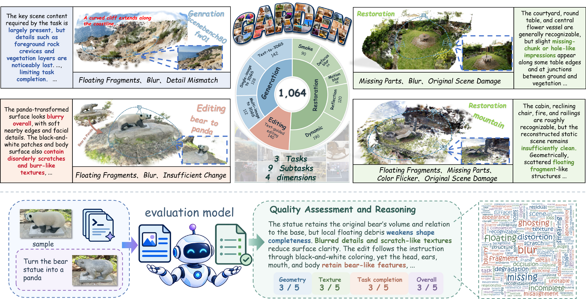

# GARDEN: Benchmarking and Improving Quality Evaluation and Understanding of 3D Gaussian Splatting in Generation, Editing, and Restoration

## Abstract

As 3D Gaussian Splatting (3DGS) is more widely used in generation, editing, and restoration, the evaluation of 3DGS results has become increasingly important. A reliable quality assessment of the 3DGS results requires considering both perceptual quality and task completion. Existing methods often target individual tasks, and their scores provide a limited explanation of the defects in the 3DGS results. To address these limitations, we construct GARDEN, a database of 1,064 rendered samples spanning nine subtasks across generation, editing, and restoration. GARDEN provides expert ratings for geometric structure, texture appearance, task completion, and overall quality, along with diagnostic rationales. We further propose UniGEM, a unified 3D-aware multimodal large language model framework for task-aware quality assessment and interpretation. UniGEM fuses cross-view features extracted by a frozen geometry encoder with the corresponding visual tokens from the sampled video frames. The model uses the fused representations together with available task conditions to predict quality scores for multiple perspectives and generate diagnostic rationales. Extensive experiments on GARDEN show the superior performance of UniGEM in assessing quality across three tasks and four perspectives. Its diagnostic rationales also achieve the highest aggregate score among the compared methods.

